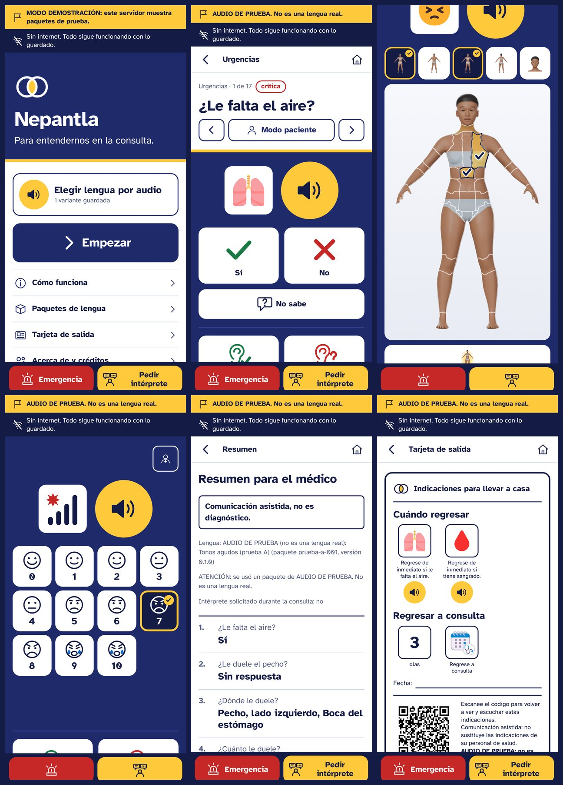

# Nepantla

*Nepantla* es una palabra náhuatl: «en medio», el lugar entre dos orillas.

Es una app web que **funciona sin internet** para que una persona que habla
una lengua indígena de México y el personal de salud que la atiende se
entiendan en una consulta. Usa **solo audios grabados y revisados por
hablantes**, pictogramas, un mapa del cuerpo y una escala de dolor.

**No es** un traductor, ni un chatbot, ni una herramienta de diagnóstico. No
usa inteligencia artificial generativa ni reconocimiento de voz, no tiene
cuentas de usuario y no guarda datos de pacientes. No sustituye a las
personas intérpretes: el botón «Pedir intérprete» está en todas las pantallas.

**Sitio del proyecto, con video de 78 s:** https://pyautosolutions.github.io/nepantla/



## Estado actual, sin adornos

| | |
|---|---|
| Software | Completo y probado (164 pruebas automáticas) |
| Demo en vivo | https://pyautosolutions.github.io/nepantla/demo/ (sin servidor) y https://nepantla-demo-production.up.railway.app (con servidor), solo audio de prueba |
| Lighthouse (móvil) | Rendimiento 99 · Accesibilidad 96 · Buenas prácticas 100 · SEO 60 |
| Paquetes de lenguas reales | **Ninguno todavía** |
| Frases en español | Borrador **sin revisión clínica** |
| ¿Se puede usar con pacientes? | **No todavía.** Ver `docs/PENDIENTES.md` |

Los dos paquetes que vienen en `packs/` son **AUDIO DE PRUEBA**: tonos
generados por computadora, sin voz. Sirven para probar y mostrar la app.

## Probarla en dos minutos

Hace falta Python (se probó con la versión 3.13) y ffmpeg.

```bash
pip install -r requirements.txt
NEPANTLA_DEV_MODE=1 uvicorn backend.main:app --port 8000 --no-access-log
```

Abre <http://localhost:8000>. Luego:

1. **Paquetes de lengua** → «Guardar para usar sin internet».
2. Vuelve al inicio → **Empezar** → elige la variante por audio.
3. Abre un escenario y responde. Prueba el botón **Modo paciente**.
4. Pon el teléfono en modo avión y recarga: todo sigue funcionando.

Sin `NEPANTLA_DEV_MODE=1` la app arranca en modo normal y no muestra ningún
paquete, porque todavía no existe ninguno real. Eso es correcto.

En Windows (PowerShell): `$env:NEPANTLA_DEV_MODE=1; uvicorn backend.main:app --port 8000 --no-access-log`

## Demo gratis, sin servidor

La app de consulta no necesita servidor para mostrarse. Este comando arma una
carpeta `dist/` con la app y los paquetes de AUDIO DE PRUEBA:

```bash
pip install -r requirements-dev.txt
python scripts/build_static_demo.py
```

Esa carpeta se puede hospedar gratis en cualquier sitio de archivos
estáticos. El repositorio ya trae el flujo `.github/workflows/demo.yml`, que
la publica en **GitHub Pages**, en `/demo/`, junto con el sitio del proyecto
(`docs/index.html`), en cada `push` a `main` (o `master`). En este
repositorio ya está activo: https://pyautosolutions.github.io/nepantla/demo/.
En una copia propia se activa en *Settings → Pages → Source: GitHub Actions*
(en el plan gratuito el repositorio debe ser público). Mientras Pages no esté
activado, el flujo no publica nada y termina sin error.

En la demostración estática no hay estudio de grabación, y la app no envía
contadores ni reportes. Los audios de cada paquete viajan juntos en un solo
archivo (`api/packs/<id>/audio.json`). Solo lleva paquetes de prueba: una voz
real nunca debe quedar en una copia estática, porque ahí nadie podría
retirarla; si el script encuentra un paquete real, se detiene.

## Qué hace

**En la consulta**

- Elegir la variante por audio: suena un saludo en cada una y la persona toca la que entiende.
- Seis escenarios con 83 frases: urgencias, embarazo, niño enfermo, medicinas, consentimiento y señales de alarma.
- Cada frase tiene dos orillas: arriba el español para el personal; abajo el audio y las respuestas para el paciente.
- Respuestas sin escribir: sí / no / no sabe, pictogramas a color, mapa del cuerpo con un cuerpo humano realista (mujer u hombre; frente, espalda y la cara de cerca; 81 zonas que cubren todo el cuerpo, más «me duele todo el cuerpo»), dolor de 0 a 10 con caritas y «desde cuándo».
- «Entendí» y «No entendí» en cada frase. Si no entiende dos veces, la app propone pedir intérprete.
- Modo paciente: sin texto obligatorio y con botones de 56 px o más.
- Modo emergencia: de un toque, cinco preguntas críticas.
- Resumen en español para el médico, con la leyenda «Comunicación asistida, no es diagnóstico».
- Tarjeta de salida con pictogramas y código QR.

**En el estudio de grabación** (necesita internet)

- La persona hablante recibe un enlace, acepta el consentimiento, recibe su código de retiro y graba una frase a la vez.
- Dos personas revisan cada grabación; una de ellas debe ser intérprete de la lengua.
- Los guardianes de la comunidad publican el paquete y pueden retirar frases o el paquete completo.
- Cualquier hablante puede retirar su voz en `#/retirar`.

Cómo se organiza todo eso: `docs/GOVERNANCE.md`.

## Armar un paquete real, paso a paso

1. Define el token de coordinación y arranca el servidor:
   `NEPANTLA_ADMIN_TOKEN="un-secreto-largo-de-24-o-más" uvicorn backend.main:app`
2. Entra a `#/admin`, crea el paquete (lengua, variante, comunidad, licencia que eligió la comunidad, guardianes).
3. Crea un enlace para cada persona: hablantes, dos revisores (marca quién es intérprete) y guardianes. Mándalos por un medio privado; cada enlace se muestra una sola vez.
4. Cuando las frases tengan doble revisión, un guardián entra con su enlace y publica.

## Pruebas

```bash
pip install -r requirements-dev.txt
python -m pytest -q                    # servidor: 140 pruebas
node --test tests_js/core.test.mjs     # lógica de la app: 10 pruebas

playwright install chromium            # solo la primera vez
python -m pytest e2e -q                # navegador de verdad: 14 pruebas
```

Las de navegador incluyen las que pide la especificación: reproducción de
audio, **modo avión completo**, resumen correcto, que `/api/usage` no guarde
nada identificable, accesibilidad básica, primera carga en 3G simulado y el
recorrido entero del estudio con un micrófono falso.

## Estructura

```
backend/            Servidor FastAPI + SQLite
  routes/           packs, usage, reports, studio, withdraw
  tests/            Pruebas del servidor (pytest)
frontend/           La PWA: HTML, CSS y JavaScript sin frameworks
  app.js            Arranque, estado en memoria y navegación
  sw.js             Service worker (modo sin internet)
  js/               core (reglas), store (IndexedDB), net, audio, vistas
  data/phrases.es.json   Las frases en español
  icons/pictos.svg  124 pictogramas (56 a color de Fluent Emoji, MIT)
  img/cuerpo/       mapa del cuerpo: renders del modelo 3D de MakeHuman (CC0)
packs/              Paquetes de AUDIO DE PRUEBA en el formato abierto
docs/               Privacidad, gobernanza, atribuciones, formato, fuentes, pendientes
scripts/            Generar audios de prueba, iconos, la lista del service worker y el demo estático
e2e/                Pruebas en navegador (Playwright)
tests_js/           Pruebas de la lógica de la app (node)
```

Si agregas o quitas un archivo en `frontend/`, corre
`python scripts/update_shell.py` para que el service worker lo guarde.

## Configuración

| Variable | Valor por defecto | Para qué |
|----------|-------------------|----------|
| `NEPANTLA_DEV_MODE` | apagado | `1` = modo demostración: muestra borradores y paquetes de prueba |
| `NEPANTLA_ADMIN_TOKEN` | vacío | Secreto de coordinación (mínimo 24 caracteres). Vacío = estudio desactivado |
| `NEPANTLA_DATA_DIR` | `./data` | Base SQLite, audios y respaldos |
| `NEPANTLA_PACKS_DIR` | `./packs` | Carpeta de paquetes que se importan al arrancar |
| `NEPANTLA_IMPORT_EXAMPLE_PACKS` | encendido | `0` = no importar los paquetes de `packs/` |
| `NEPANTLA_FORCE_HTTPS` | apagado | `1` = redirigir a HTTPS (detrás de un proxy) |
| `NEPANTLA_BACKUPS` / `NEPANTLA_BACKUP_KEEP` | encendido / 14 | Respaldo diario de la base y cuántos conservar |
| `NEPANTLA_MAX_UPLOAD_BYTES` | 3 MB | Tamaño máximo de una grabación |
| `NEPANTLA_MAX_AUDIO_SECONDS` | 30 | Duración máxima de una grabación |
| `NEPANTLA_SESSION_DAYS` | 30 | Vigencia de los enlaces del estudio |

## Subir a GitHub

1. En GitHub, crea un repositorio **vacío** llamado `nepantla`: sin README,
   sin `.gitignore` y sin licencia (ya vienen aquí).
2. Abre una terminal en esta carpeta (la que tiene este `README.md`) y corre:

```bash
git init
git add .
git commit -m "Nepantla: MVP 0.1.0"
git branch -M main
git remote add origin https://github.com/TU_USUARIO/nepantla.git
git push -u origin main
```

`.gitattributes` deja los archivos de texto con saltos de línea LF también en
Windows, así que `git add` no muestra avisos de CRLF.

## Desplegar en Railway

**Ya está desplegado** en modo demostración: https://nepantla-demo-production.up.railway.app
(proyecto `nepantla`, servicio `nepantla-demo`). Railway construye con el
`Dockerfile` (trae ffmpeg), revisa `/api/health` (`railway.json`) y vuelve a
desplegar solo en cada `push` a `main`.

- El volumen `nepantla-datos` está montado en `/data`: ahí viven la base, los
  audios y los respaldos. Sin volumen, todo se perdería en cada despliegue.
- Variables: `NEPANTLA_DEV_MODE=1`, `NEPANTLA_FORCE_HTTPS=1` y
  `NEPANTLA_DATA_DIR=/data`.
- Sin `NEPANTLA_ADMIN_TOKEN`, el estudio de grabación queda apagado (así debe
  estar un demo público). Cuando quieras usarlo, agrega esa variable con un
  secreto largo que solo tú conozcas.
- Antes de un uso real: revisa qué guardan los registros de Railway (IP,
  hora). Eso queda fuera del código; ver `docs/PRIVACY.md`.

Un demo público debe verse siempre como demo. No quites la cinta amarilla ni
presentes los tonos de prueba como si fueran una lengua.

## Privacidad en corto

- Las respuestas viven solo en la memoria de la pantalla y se borran al terminar la consulta.
- Al servidor llegan únicamente conteos: día, paquete, evento. Sin hora, sin IP, sin dispositivo.
- La app no carga nada de otros servidores y no usa cookies.

Detalle y cómo comprobarlo: `docs/PRIVACY.md`.

## Limitaciones conocidas

- **Formato de audio.** Los audios son Opus dentro de Ogg, que funciona en Chrome y Firefox (el Android de gama baja es el objetivo). Algunos iPhone con versiones antiguas de iOS no lo reproducen; la app lo detecta y avisa. Hay que probarlo en teléfonos reales.
- **Grabación en iPhone.** El estudio usa `MediaRecorder`; el servidor acepta WebM, MP4, Ogg y WAV y lo convierte todo a Opus. Falta verificarlo en Safari/iOS con un teléfono real.
- **Teléfonos que no se conectan.** Una voz retirada se borra de cada teléfono en su siguiente conexión. Uno que nunca vuelve a conectarse conserva lo que tenía.
- **Lighthouse y lectores de pantalla.** Lighthouse 13.6.0 (PageSpeed Insights, móvil) sobre el demo: rendimiento 99, accesibilidad 96, buenas prácticas 100 y SEO 60. El SEO bajo es a propósito: la página pide no aparecer en buscadores (`noindex`) porque es una demostración. La accesibilidad pierde puntos porque la barra fija de «Emergencia» y «Pedir intérprete» tapa los últimos enlaces del inicio en teléfonos chicos hasta que se desplaza la pantalla; se decidió dejarla así (razones en `PROJECT_PROGRESS.md`). Falta recorrer la app con TalkBack en un Android real.

## Documentos

- `docs/PRIVACY.md`: qué se guarda, dónde y por qué.
- `docs/GOVERNANCE.md`: hablantes, revisores, guardianes y retiro de voces.
- `docs/PACK_FORMAT.md`: el formato abierto del paquete de lengua.
- `docs/ATTRIBUTIONS.md`: licencias de pictogramas, imágenes del cuerpo, letra y bibliotecas.
- `docs/FUENTES.md`: listas oficiales consultadas para las frases.
- `docs/PENDIENTES.md`: lo que falta y solo pueden hacer personas.
- `PROJECT_PROGRESS.md`: bitácora de avance del desarrollo.

## Licencias

Código: MIT. Pictogramas originales y frases en español: CC BY 4.0. Pictogramas a color: MIT (Microsoft). Imágenes del cuerpo: CC0. **Las voces no
están cubiertas por estas licencias**: cada paquete lleva la que eligió su
comunidad.
